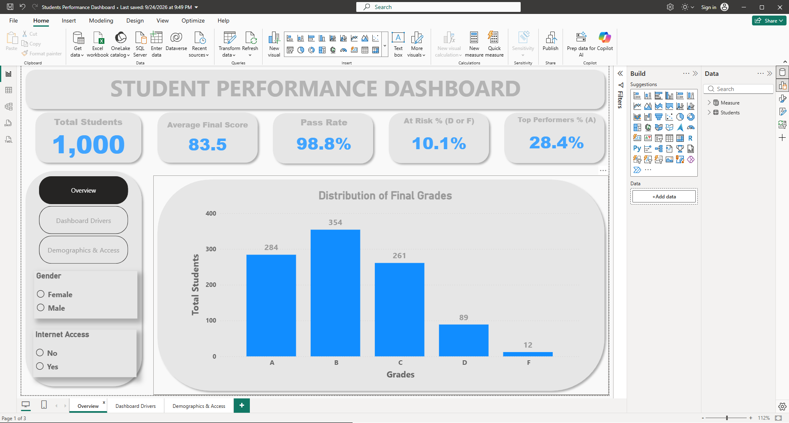
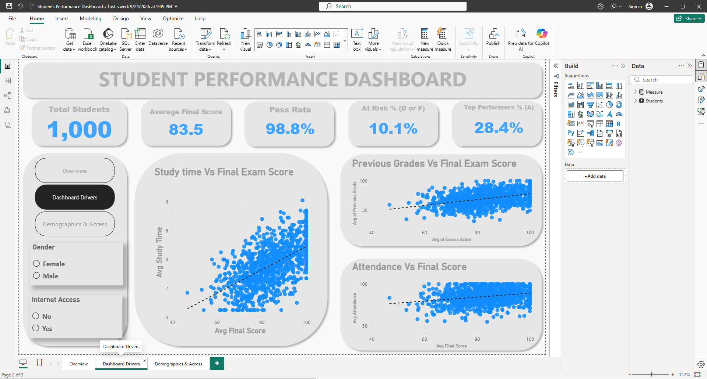
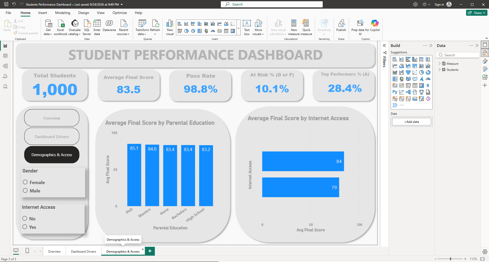

<div align="center">


# 🎓 Student Performance Dashboard

**An interactive Power BI dashboard uncovering what drives student academic success.**


</div>

---

## 📌 Overview

This project analyses the academic performance of **1,000 students** to identify the factors that influence final exam outcomes. The dashboard combines headline KPIs with exploratory visuals covering study time, previous grades, attendance, parental education, and internet access.

**Outcome:** 98.8% of students pass, but **10.1% (101 students) are at risk** (grade D or F). Study time and previous grades are the strongest visible drivers of final scores, while attendance shows a weak relationship.

---

## 🎯 Business Questions

- What share of students pass, and which students are at risk?
- Do study time, attendance, or previous grades drive final scores?
- Do internet access and parental education affect performance?
- How do results differ by gender?

---

## 📊 Key Metrics

| Metric | Value |
|---|---|
| Total Students | 1,000 |
| Average Final Score | 83.5 |
| Pass Rate | 98.8% |
| At Risk % (D or F) | 10.1% |
| Top Performers % (A) | 28.4% |

---

## 🖼️ Dashboard Preview

### 1. Overview


### 2. Dashboard Drivers


### 3. Demographics & Access


---

## 🔍 Key Insights

| # | Finding | Evidence |
|---|---|---|
| 1 | Most students perform well | 98.8% pass rate; 83.5 average score |
| 2 | A meaningful group is at risk | 101 students (10.1%) have a D or F |
| 3 | Study time is a strong driver | Clear upward trend against final score |
| 4 | Previous grades predict outcomes | Positive trend line |
| 5 | Attendance has a weak link to scores | Nearly flat trend line |
| 6 | Internet access shows a gap | 84 vs 79 average final score |
| 7 | Parental education has a small effect | Averages range only from 83.2 to 85.1 |

Full analysis and recommendations: [`docs/insights.md`](docs/insights.md)

---

## 🛠️ Tools & Skills Demonstrated

| Tool / Skill | Application |
|---|---|
| Power BI Desktop | Dashboard design and navigation |
| Power Query | Data cleaning and transformation |
| DAX | KPI measures |
| Data modelling | Table structure and relationships |
| Data storytelling | Insight-led layout and recommendations |

---

## 📁 Repository Structure

```
student-performance-dashboard-powerbi/
├── README.md
├── LICENSE
├── .gitignore
├── .gitattributes
├── dashboard/
│   └── Students_Performance_Dashboard.pbix
├── data/
│   ├── raw/
│   └── processed/
├── docs/
│   ├── data_dictionary.md
│   ├── dax_measures.md
│   ├── insights.md
│   └── methodology.md
├── assets/
│   ├── banner.png
│   └── screenshots/
│       ├── 01_overview.png
│       ├── 02_dashboard_drivers.png
│       └── 03_demographics_access.png
└── reports/
    └── dashboard_export.pdf
```

---

## ▶️ How to Use

1. Clone the repository:
   ```bash
   git clone https://github.com/REPLACE_USERNAME/student-performance-dashboard-powerbi.git
   ```
2. Open `dashboard/Students_Performance_Dashboard.pbix` in **Power BI Desktop**.
3. If prompted, point the data source to the file in `data/raw/`
   (*Home → Transform data → Data source settings*).
4. Use the page buttons (Overview, Dashboard Drivers, Demographics & Access) and the **Gender** and **Internet Access** slicers to explore.

---

## 📚 Documentation

| Document | Purpose |
|---|---|
| [Data Dictionary](docs/data_dictionary.md) | Column definitions |
| [DAX Measures](docs/dax_measures.md) | KPI logic |
| [Insights](docs/insights.md) | Findings and recommendations |
| [Methodology](docs/methodology.md) | Approach, design choices, limitations |

---

## ⚠️ Limitations

- Correlation does not imply causation.
- Scatter plots show averages and do not control for other variables.
- The ~2-point spread across parental education groups is small and may not be meaningful.
- The dataset may not represent all student populations, so findings may not generalise.

---

## 🚀 Future Improvements

- Add a regression or correlation analysis to quantify driver strength.
- Add a table listing at-risk students for early intervention.
- Add tooltips and drill-through pages.
- Publish to Power BI Service with a public link.

---

## 👤 Author

**Derrick Tecson**
Data Analyst | SQL · Python · Excel · Power BI

[LinkedIn](https://www.linkedin.com/in/derrick-tecson-6a8b9b214/?lipi=urn%3Ali%3Apage%3Ad_flagship3_profile_view_base_contact_details%3BT10Y4XbRRKmJl%2FSYEpq5gg%3D%3D) · [Email](tecsonderrick@gmail.com)

---

<div align="center">

⭐ If you found this project useful, please star the repository.

</div>
